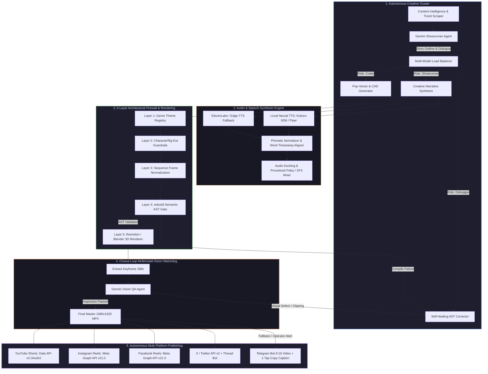

# 🎬 Autonomous Multi-Agent Video & Social Distribution Engine

> **An enterprise-grade, end-to-end automated workflow engine that conceives, scripts, animates, verifies, and distributes viral short-form video content across YouTube Shorts, Instagram Reels, Facebook Pages, X (Twitter), and Telegram with closed-loop QA and zero human intervention.**

[](https://www.typescriptlang.org/)
[](https://www.remotion.dev/)
[](https://www.blender.org/)
[](https://aistudio.google.com/)
[](https://developers.facebook.com/)
[](https://opensource.org/licenses/MIT)

---

## 🏗️ System Architecture & Workflow Flow



---

## ⚡ Key Engineering Highlights

### 1. 5-Layer Architectural Compiler Firewall
To eliminate LLM hallucinations and anachronistic asset contamination (e.g., rendering ancient crowns or turbans inside modern corporate offices), the engine enforces a strict 5-layer compile-time gate:
- **Layer 1: Isolated Genre Theme Registry (`genre_theme_registry.js`)**: Dynamic in-context prompt generation ensuring genre-incompatible tokens are physically absent from LLM inputs.
- **Layer 2: Hardware-Level Component Guardrails (`CharacterRig.tsx`)**: React rig enforcement that refuses to render conflicting attires even if requested.
- **Layer 3: Sequence Frame Normalization**: Enforces strict local relative frame timing ($[0, 20]$ frames) inside Remotion sequences, preventing invisible character render bugs.
- **Layer 4: In-Memory esbuild AST Validator (`validate_pop_vector_ast.js`)**: Real-time TypeScript/TSX parsing in `< 10ms` checking for syntax errors, forbidden filters (`feDisplacementMap`), coordinate staging collisions, and era purity violations before code ever touches disk.
- **Layer 5: Zero-Cloud Fallback**: Local AST analysis runs completely detached from cloud AI quotas.

### 2. Closed-Loop Multimodal Vision Watchdogs
Rendering code isn't trusted blindly. Both the 2D and 3D pipelines render intermediate still frames and feed them to high-resolution Gemini Vision agents:
- **Audit Rules**: Probes for safe-zone typography margins, edge clipping, background contrast ratio, facial distortion, and un-anchored floating geometry.
- **Self-Healing Loop**: If the auditor finds an issue (e.g., text obscured by native Reels action buttons), the Debugger Agent receives structured coordinates and auto-repairs the TSX code in `< 3 seconds`.

### 3. Multi-Model LLM Clustering & Dynamic Load Balancing (`gemini_cluster.js`)
- Segregates tasks across dedicated concurrency pools: **Showrunner** (creative pacing), **Visual Coder** (SVG/CAD generation), and **Debugger** (AST repair).
- Built-in circuit breakers with exponential backoff and transparent failovers across OpenRouter, Groq, and Mistral when rate limits (HTTP 429) occur.

### 4. Enterprise Social Media Distribution Suite
- **YouTube Data API v3**: Automatic OAuth2 refresh token lifecycle management with metadata, curiosity hooks, and unlisted/public deployment gates.
- **Meta Graph API v21.0**: Resumable chunked video upload for Instagram Reels and Facebook Pages, with faststart (`+faststart`) atom relocation and distributed edge propagation polling.
- **X (Twitter) Developer API v2**: Chunked INIT/APPEND/FINALIZE uploads with automated threaded engagement replies.
- **Telegram Ops Bot (`telegram_notifier.js`)**: Real-time delivery of 9:16 streaming video directly to operational mobile devices, accompanied by a 1-tap copy-paste caption code block if external API quotas are constrained.

---

## 📁 Repository Structure

```
.
├── scripts/
│   ├── run_oddly_autonomous.js          # Phase 1 Master: 2D Pop-Vector pipeline orchestrator
│   ├── autonomous_pop_vector_engine.js  # Generative CAD vector compiler & prompt synthesis
│   ├── validate_pop_vector_ast.js       # In-memory esbuild AST safety & era validator
│   ├── test_pop_vector_firewall.js      # Automated 26-test suite verifying the 5-layer firewall
│   ├── run_relatable_autonomous.js      # Phase 2 Master: 3D Blender comedy showrunner
│   ├── gemini_cluster.js                # Multi-key load balancer & fallback circuit breaker
│   ├── pop_vector_vision_watchdog.js    # Multimodal closed-loop visual QA agent
│   ├── publish_phase1.js                # Meta Graph & YouTube publisher for 2D channel
│   ├── publish_phase2.js                # Meta Graph, YouTube, X & Reddit publisher for 3D channel
│   ├── telegram_notifier.js             # Telegram 9:16 vertical video & clipboard alerts
│   ├── kokoro_tts.py                    # Local offline 82M neural TTS synthesizer
│   └── setup_phase1_scheduler.ps1       # Windows Task Scheduler automated job registrant
├── src/
│   ├── Root.tsx                         # Master Remotion composition registry & metadata calculator
│   ├── components/
│   │   ├── rigs/CharacterRig.tsx        # Guardrailed modular vector character anatomy
│   │   ├── rigs/HeroProp.tsx            # Parametric animated vector props (devices, charts, traps)
│   │   ├── rigs/RoomEnvironment.tsx     # Vector backgrounds (modern office, server room, etc.)
│   │   ├── OddlyCaptions.tsx            # Word-level kinetic popping subtitle engine
│   │   └── KineticSubtitles.tsx         # Spring-damped typography highlighter
│   └── scenes/
│       └── AutonomousPopVectorExplainer.tsx # Dynamic container for compiled vector scenes
├── blender_engine/                      # Procedural 3D stage builder, lighting rigs & camera animators
├── package.json                         # Node.js dependencies & execution scripts
├── requirements.txt                     # Pinned Python production dependencies
└── .env.example                         # Structured environment variable template
```

---

## 🚀 Quickstart & Setup

### Prerequisites
- **Node.js**: `v20.19.0` or higher
- **Python**: `3.10` or higher
- **FFmpeg**: Installed and available in your system `PATH`
- **Blender** *(Optional, for Phase 2 3D rendering)*: `v4.2` or `v4.3`

### 1. Installation
Clone the repository and install both Node.js and Python dependencies:
```bash
# Clone the repository
git clone https://github.com/Animus004/Passive_income_test_kit.git
cd Passive_income_test_kit

# Install Node.js packages
npm install

# Install Python packages
pip install -r requirements.txt
```

### 2. Environment Configuration
Copy the provided `.env.example` template and configure your API credentials:
```bash
cp .env.example .env
```
*(Fill in your `GEMINI_API_KEY`, and optionally Meta/YouTube credentials for automated social publishing).*

---

## 💻 CLI Usage & Execution Commands

### 1. Run the Phase 1 2D Pop-Vector Engine
Generate an entire episode from scratch (topic selection -> script -> CAD generation -> AST gate -> render -> QA):
```bash
# Generate video locally
npm run oddly:run

# Or run with explicit publishing flag
node scripts/run_oddly_autonomous.js --publish
```

### 2. Run the 5-Layer Architectural Firewall Test Suite
Execute the 26-test suite verifying syntax safety, local frame limits, collision detection, and era purity:
```bash
node scripts/test_pop_vector_firewall.js
```

### 3. Run the Phase 2 3D Comedy Series
Generate a 3D dual-character short with procedural camera moves and comic foley:
```bash
# Run in English
npm run relatable:run

# Run and publish live across all connected platforms
npm run relatable:daily
```

### 4. Interactive Remotion Development Studio
Inspect animations, rigs, and typography frame-by-frame in real time:
```bash
npm run dev
```

### 5. Automated Background Scheduling
Register resilient Windows Task Scheduler automated slots:
```powershell
powershell -ExecutionPolicy Bypass -File scripts/setup_phase1_scheduler.ps1
```

---

## 🛡️ Reliability & Security Measures

- **Zero Tracked Credentials**: Continuous pre-commit scanning ensures all secrets, tokens, OAuth client IDs, and session cookies are strictly loaded via `process.env` / `os.getenv`.
- **Stateless Rendering**: Video generation builds into ephemeral, gitignored output directories (`out/`, `scratch/`), preventing workspace bloat.
- **Graceful Degradation**: If an external social API (such as Meta or X) throttles or returns edge propagation latency, the pipeline automatically archives the high-resolution master video, constructs a 1-tap mobile clipboard payload, and dispatches it instantly via Telegram Bot.

---

## 📜 License
This project is open-source and licensed under the [MIT License](LICENSE).
